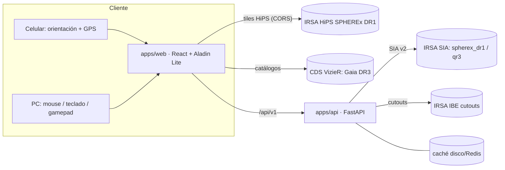

# Arquitectura

## Decisiones

- **Render del cielo en el cliente con HiPS**: IRSA publica un HiPS all-sky de SPHEREx DR1 (102 frames = 6 bandas ×
  17 canales, tiles PNG, CORS abierto). Aladin Lite lo dibuja directo y permite elegir el frame con `setSliceNumber`.
  Sin backend para la vista "cielo".
- **Serie temporal vía backend**: el HiPS es un coadd (sin tiempo). Para el "video" se consultan las imágenes nivel 2
  por época (SIA, ~1 s) y se piden cutouts por imagen. Esto es lento y el servicio de cutouts devuelve "Server busy"
  bajo carga → el backend centraliza reintentos, rate limiting, caché y pre-cálculo de los objetivos del challenge.
- **Procesamiento en Python** (astropy/numpy): reproyección a una grilla común, coadd por detector, diferencias entre
  épocas y extracción de espectros. El cliente recibe PNG/WebP + JSON livianos.
- **Modo celular**: `DeviceOrientationEvent` (+ `webkitCompassHeading` en iOS) → alt/az → RA/Dec usando
  geolocalización y tiempo sidéreo local (`src/lib/astro.ts`). Requiere HTTPS.
- **Estado en la URL** (`?ra=&dec=&fov=&frame=`) para compartir y embeber.

## Despliegue

Microsoft Azure (Global Offer de NASA Space Apps): Static Web Apps para la web y Container Apps para la API, que la web
llama por `VITE_API_URL`. La caché de cutouts va en Azure Blob Storage. Ver [deploy-azure.md](deploy-azure.md).
